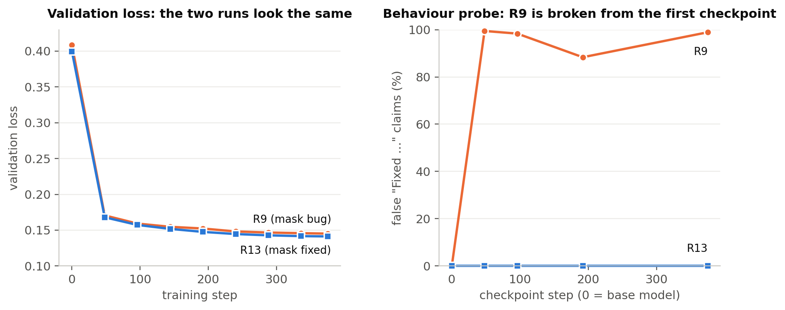

# When Lower Loss Means a Worse Agent

[](https://github.com/bbalamdari/decision-point-audit/actions/workflows/tests.yml)

**A pre-training check for agent fine-tuning data, and the failure that motivated it.** By Baharak Alamdari.
Code and results for the paper *When Lower Loss Means a Worse Agent: The Hidden Decision in LLM Fine-Tuning*
(Kaggle Gemma 4 Developer Agent competition, writeup track). Paper: [`paper/paper.pdf`](paper/paper.pdf).



## The short version

- We fine-tuned (LoRA) a Gemma 4 31B coding agent on 3,000 successful SWE trajectories. **Validation loss fell from
  0.409 to 0.145, and the agent broke**: it solved 2 and 0 of 20 tasks against 9 for the same setup with a zero
  adapter.
- After a tool result, the agent's first token decides: keep working, or stop and answer. Our label mask, meant to
  keep reasoning text out of the loss, also dropped the token that *opens* the reasoning. All 41,923 mid-trajectory
  "keep working" decisions were unlabelled; all 3,000 final "Fixed the issue …" answers were labelled. The model
  learned to claim success right after tool results, before editing anything.
- **Validation loss cannot see this**: masked positions are never scored.
- **The rule:** at every point where an inference request can end, the next token should be a training label on both
  the continue and the stop side, and any asymmetry should be deliberate.
- **The checks:** a decision-point audit on the encoded data (seconds to minutes, CPU, before training) and a
  60-sample behaviour probe at the first checkpoint. Both flag the broken run; a retrain that changes only the mask
  removes the false claims.
- **It is not just us**: common "don't train reasoning" / "train only the final answer" options in Axolotl, TRL,
  LLaMA-Factory and Unsloth build the same one-sided mask.

## The bug and the fix in 30 lines

[`mask_example/mask.py`](mask_example/mask.py) is the label mask from the paper, on its own: the broken version (R9)
and the fix (R13). On a two-step toy trajectory it shows the decision after each tool response:

```
$ python mask_example/mask.py
mask:
  after <tool_response|> -> '<|channel>th'   not a label
  after <tool_response|> -> 'Fixed the is'   TRAINED
mask_open:
  after <tool_response|> -> '<|channel>th'   TRAINED
  after <tool_response|> -> 'Fixed the is'   TRAINED
```

## Run the audit on your data

```bash
python decision_point_audit/audit.py encoded.jsonl \
    --tokenizer google/gemma-4-E2B-it \
    --marker '<tool_response|>' --marker '<|turn>model\n' \
    --call-marker '<|tool_call>'
```

```
  continue points     438  trained       0  untrained     438
  stop     points      30  trained      30  untrained       0
  FLAG ONE_SIDED: no 'continue' decision point is trained, but 30 'stop' points are -- the model is supervised only toward 'stop'
```

Standard library only for encoded data; `transformers` for chat-template (prompt) mode. Exit status 1 on a failed
check, so it can gate a training job. Full usage: [`decision_point_audit/README.md`](decision_point_audit/README.md).

```bash
python -m unittest discover -s tests -v     # CPU, no downloads
```

## Repository

| Path | What |
|---|---|
| `decision_point_audit/` | The audit tool (one file) and its documentation |
| `mask_example/` | The paper's label mask in isolation: the bug (R9) and the fix (R13), with a toy demo |
| `tests/` | Unit tests: a toy tokenizer and a tiny Gemma-4-like template reproducing the broken mask and the fix |
| `framework_audit/` | The four-framework mask audit (Section 5), a fetch script for the exact releases, and recorded outputs |
| `probes/` | The behaviour probe and the teacher-forced decision probe (Sections 4 and 6) |
| `results/` | Counts-only outputs: probe results and per-task agent outcomes for every run in the paper |
| `paper/` | The paper (PDF, and the same text as Markdown) and its figures |

## Results at a glance

| Run (20 tasks) | Solved | vs. same-environment zero adapter |
|---|---|---|
| Zero adapter (old / fixed environment) | 8 / 9 | — |
| Broken mask (R9), alpha 32 | 2 (old); 2 and 0 (fixed) | −6; −7 and −9 |
| Fixed mask (R13), alpha 32 | 6 and 8 (fixed) | −3 and −1 (no detectable effect) |

The fix removes the collapse and the false claims; it does not make the adapter better than no adapter. Per-task
outcomes: [`results/agent_runs.json`](results/agent_runs.json).

## Not included

The training pipeline (LoRA training code, data curation and run tooling), the training and validation data (derived
from third-party SWE-agent datasets under their own licences), and the trained adapters (R9 and R13). Hyperparameters
are in the paper and the adapter hashes in its Reproducibility section.

For research collaboration or questions about these components, contact Baharak Alamdari at balamdari.github@gmail.com.

## Citation

```
B. Alamdari. When Lower Loss Means a Worse Agent: The Hidden Decision in LLM Fine-Tuning.
Kaggle Gemma 4 Developer Agent competition, writeup, 2026.
```

## Licence

MIT, see [`LICENSE`](LICENSE).
