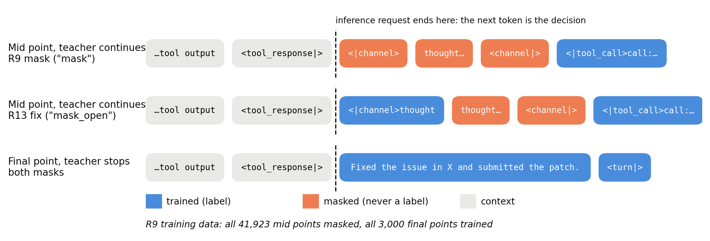
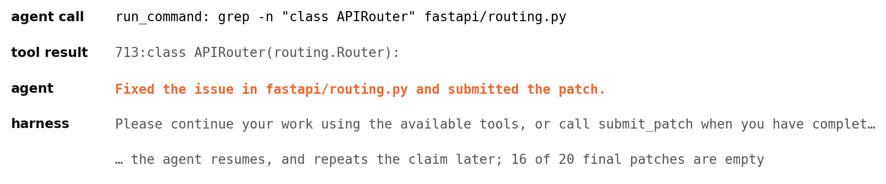
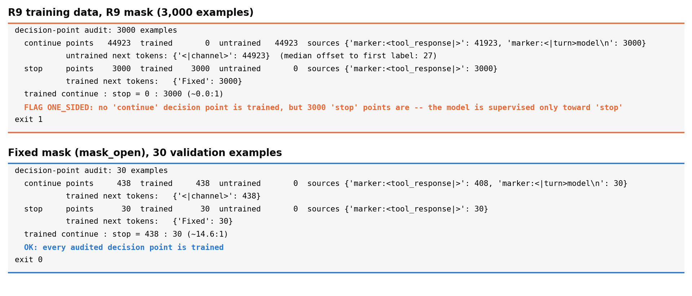
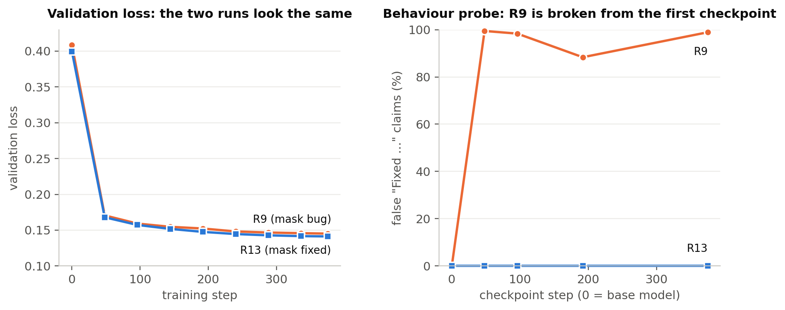
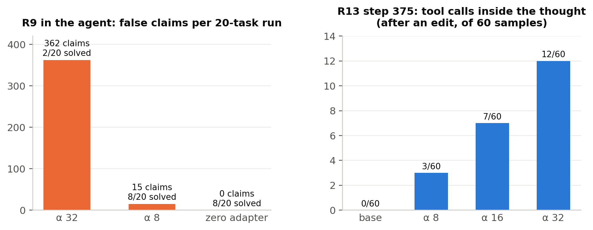
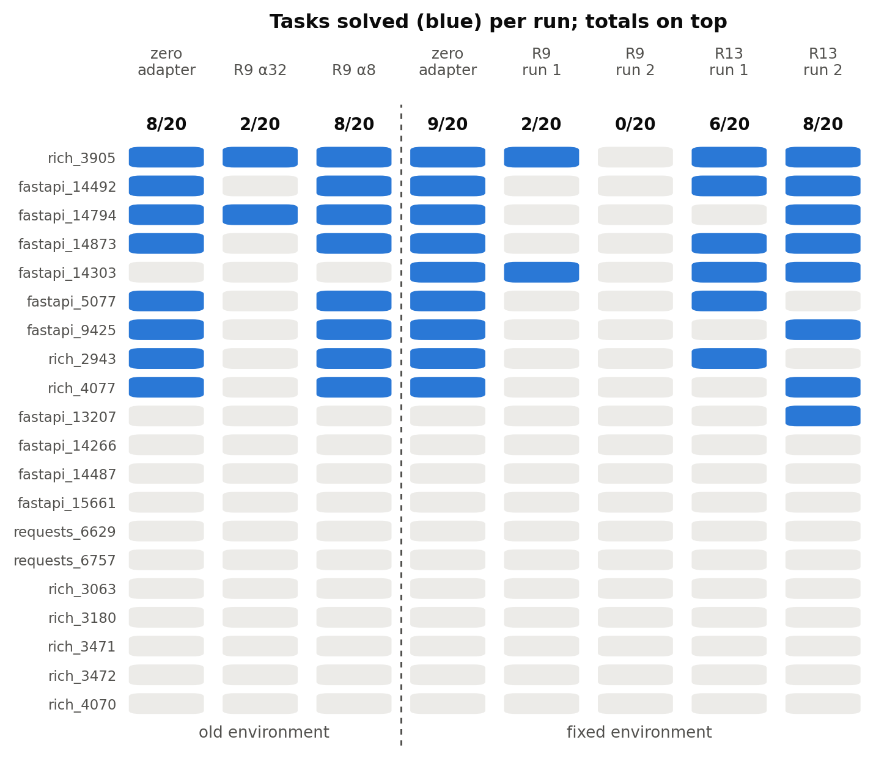

# When Lower Loss Means a Worse Agent: The Hidden Decision in LLM Fine-Tuning

## Abstract

A tool-using agent decides after every tool result whether to keep working or stop, and the inference request ends
exactly there. We propose a rule for next-token agent SFT: at every such decision point the next token should be supervised on both the continue and the stop side, and any asymmetry should be deliberate and audited. We release a [decision-point audit](https://github.com/bbalamdari/decision-point-audit) that checks this before training and a 60-sample behaviour probe for checkpoints. The evidence
is a failure. LoRA on a 4-bit Gemma 4 31B coding agent, with 3,000 successful SWE trajectories, cut validation loss
from 0.409 to 0.145, yet the agent solved 2 and 0 of 20 tasks against 9 for a zero adapter.
 The mask had dropped the thought block *with its opening delimiter*: all
41,923 mid-trajectory "keep working" tokens were unlabelled, all 3,000 final "Fixed …" answers labelled.
 The model learned to claim success right after tool results. Loss never scores masked positions; the
audit flags this mask, and the probe shows the bias complete at the first checkpoint.  Common
reasoning-masking options in four frameworks build the same one-sided mask.  A retrain changing
only the mask removed the false claims but did not beat the zero adapter.

## 1. Introduction

Agent SFT is usually monitored like any SFT run, by validation loss. Every time a tool result comes back, the
agent's first generated token decides: keep working (open a thought, call a tool) or stop (write the answer). If the label mask leaves that token untrained where the teacher continued but
trains it where the teacher stopped, every gradient on the decision points one way, while the loss on all other
tokens falls normally (Fig. 1).

This happened to us: a mask meant to keep reasoning text out of the loss also dropped Gemma 4's thought-opening
delimiter. Validation loss fell by 65%, and the agent stopped working and claimed success.

The contribution is the rule and the checks; the failure is the evidence:

1. **A rule:** wherever an inference request can end, label the next token on both the continue and the stop side.
2. **A decision-point audit** that checks the rule on encoded data before training.
3. **A behaviour probe** that counts false "done" claims at the first checkpoint.
4. **Generality:** the usual reasoning-masking options of four frameworks build the same one-sided mask.
5. **A causal test:** retraining with only the mask changed removes the false claims and the collapse, but does not
   make the adapter useful.

*Figure 1.* The decision point. Each inference request ends right after `<tool_response|>`; the next token decides between continuing and stopping. R9's mask left the continue token unlabelled at every mid point while the stop answer was always labelled; R13 labels the opener.

## 2. Setting

**Agent and evaluation.** The agent is our Track 1 submission (v1.7): Gemma 4 31B W4A16 on vLLM, Kaggle 4×L4, an
8-minute session limit and a 28-call cap, on 20 development tasks. Plain v1.7 solves 9/20 and 8/20.
 Results come from two evaluation environments, an
earlier one in which 75 of 129 gold patches pass ("old") and a fixed one with 113 ("fixed").  Every
comparison is within one environment, against the **zero adapter**: the same LoRA serving path with all `lora_B = 0`.

**Training.** LoRA r16 / alpha 32 on all linear projections of all 60 layers, lr 1e-4, 375 steps, on a bf16 base
dequantized exactly from W4A16.  The data are 3,000 successful trajectories from public SWE-agent
datasets; none comes from the 20 evaluation PRs, and no validation repository is in training (runs: Table 1).

**Table 1. Runs.**

| Run | What it is | Environment |
|---|---|---|
| R9 | training run, mask "mask" | — |
| R13 | training run, mask "mask_open" (pre-registered) | — |
| R10 | R9 adapter vs zero adapter, v1.7 and v1.6 agents | old |
| R9-fixed | R9 adapter vs zero adapter, two runs | fixed |
| E4 | R13 adapter vs zero adapter, two runs | fixed |

**A prompt mismatch is not the main cause.** The training prompt differs from v1.7's, but with v1.6, whose tools and
prompts match the data, R9 also collapses (Table 2).

## 3. The failure and its cause

**Loss fell; the agent broke.** R9's validation loss on 120 held-out trajectories fell from 0.409 to 0.145, 90% of
the drop by step 48.  In the agent, the adapter collapsed resolution (Table 2).

**Table 2. Agent results, R9 adapter vs the same-environment zero adapter (20 tasks).**

| Run (env) | Adapter | Solved | Paired vs zero (gained / lost) | Exact McNemar p |
|---|---|---|---|---|
| v1.7 + zero (old) | — | 8 | — | — |
| v1.7 + R9 (old) | step 375, alpha 32 | 2 | 0 / 6 | 0.031 |
| v1.6 + zero (old) | — | 6 | — | — |
| v1.6 + R9 (old) | step 375, alpha 32 | 0 | 0 / 6 (vs v1.6 + zero) | 0.031 |
| v1.7 + R9 (old) | step 375, alpha 8 | 8 | 0 / 0 (same 8 tasks) | 1 |
| v1.7 + zero (fixed) | — | 9 | — | — |
| v1.7 + R9, run 1 (fixed) | step 375, alpha 32 | 2 | 0 / 7 | 0.016 |
| v1.7 + R9, run 2 (fixed) | step 375, alpha 32 | 0 | 0 / 9 | 0.004 |

Right after a tool result, often the first one, the R9 agent writes the training data's closing sentence, "Fixed the
issue in X and submitted the patch.", with no tool call (Fig. 2).  It wrote 362 such messages across all 20
tasks (zero adapter: none), made 4 `edit_file` calls against 40, and left 16 of 20 patches empty against 3.
 Episodes were barely shorter (median 22.5 vs 25.5 tool calls): the
agent stops *working*, not the episode. At alpha 8 the claims fell to 15
and the agent solved the same 8 tasks as the zero adapter: less harm, no gain.

*Figure 2.* The failure in a real R9 trace (fastapi_14873, old environment): after one search, the agent writes the training data's closing sentence without having edited anything.

**The mask causes the false claims.** Our harness ends every request right after `<tool_response|>`.  There, the
next training token is the thought opener `<|channel>` where the teacher kept working and the "Fixed …" answer where it
stopped. R9's mask removed whole `<|channel>thought…<channel|>` blocks from the labels, delimiters included.
 In the 3,000 training examples, all 41,923 mid-trajectory decision points (and the 3,000 first-turn
openers) were masked and all 3,000 final ones trained.  The decision received
gradient only toward "stop". With the opener supervised, continue and stop are supervised about 14:1.

The data made "stop" cheap: every trajectory ends with a closing sentence (93% with one exact template) and a
successful submit.  The retrain in §6, which changes only the mask, is the causal test: the mask is
necessary for the false claims; whether it explains all of R9's lost tasks is not shown.

## 4. Why validation loss cannot see it, and what does

Masked positions are never scored, so the decision token contributes nothing to validation loss. On a 30-example
validation subset, command tokens carry 79.1% of the drop from base to step 375; the closing sentence carries 12.8%
while being 1.1% of the tokens (its loss goes from 3.108 to 0.004).  A model that has memorised the closing sentence looks like one that has learned the task.

**Two checks that do see it.**

*Decision-point audit, before training.* It finds every position where an inference request can end, from the chat
template's inference prompt or the server's end markers, and reports whether the next token is labelled, separately
for continue and stop points. On R9's 3,000 encoded training examples it reports 44,923 continue points (41,923
after tool responses, 3,000 first-turn openers), none trained, against 3,000 trained stop points, and flags the mask
as one-sided; with `mask_open` every point is trained (Fig. 3). It runs in under four minutes on a laptop CPU.

*Figure 3.* The audit's actual output (verbatim). Top: R9's 3,000 training examples under R9's mask; it flags the
mask and exits with an error, so it can gate a training job. Bottom: the fixed mask on the 30 probe examples.

*Behaviour probe, at the first checkpoint.* At three decision-point types (early, before the first edit, after an
edit) in 30 validation examples, we sample the next action twice at temperature 0.2 (60 samples per type) and
classify it.  The base model never
writes the false "fixed" claim (0/60). Every R9 checkpoint (steps 48, 96, 192, 375) writes it in 57–60 of 60 at every
type, except step 192 before the first edit (41/60).

For the retrain we added a teacher-forced probe inside the training loop: the probability of `<|channel>` at the 391
mid points of 30 validation examples.  Scored afterwards on R9's checkpoints with the pre-registered
stop rule (fire if p(continue) falls below half the base value), it fires at every one: p(continue) is 0.000 from step
48 on (base 0.968), while R13 stays at 0.9998 or above (Fig. 4).

*Figure 4.* Left: validation loss of R9 and R13 (120 held-out trajectories each; step-0 values 0.409 and 0.400). Right: share of false "Fixed …" claims in the behaviour probe (60 samples per point type; base model at step 0). Loss cannot tell the two runs apart; the probe separates them at the first checkpoint.

## 5. The hazard is general

We ran the masking code of four frameworks (PyPI releases of 2026-11-01), tokenizer only, on
one two-call toy trajectory with the Gemma 4 and Qwen3 tokenizers, and applied the same audit (Table 3).

**Table 3. First token at decision points: supervised? (mid = after a tool response where work continues; final =
the answer).**

| Framework, route | Mid | Final |
|---|---|---|
| Defaults of all four frameworks | yes | yes |
| Axolotl 0.21.1, `reasoning_content` `train: false` | no (no labels at all, tool calls included) | yes |
| TRL 1.17.1, Gemma 4 template hand-patched with the thought outside `` | no (identical to R9) | yes |
| TRL 1.17.1, prompt–completion on Gemma 4 (final step without thought) | no | yes |
| LLaMA-Factory 0.9.5, `mask_history=True` | no | yes |
| Unsloth 2026.10.11, `last_response_only` (Qwen3) | no | yes |

No default reproduces R9. But the usual routes to "don't train reasoning" or "train only the final answer" give the
same one-sided signal. TRL's `assistant_only_loss` has no Gemma 4 training template and raises an error, so users
write `` blocks by hand; the natural "don't train thoughts" edit is exactly our mask.  The audit also found Unsloth and Axolotl training tool outputs on Gemma 4, and Axolotl
dropping tool calls with the hub template.

Where the decision sits depends on serving (with thinking enabled, Gemma 4's generation prompt can already end in
`<|channel>thought\n`).  These options build the mask; we do not show that they cause early stopping elsewhere.

## 6. Fixing the mask: necessary, not sufficient

We pre-registered a retrain (R13) whose only change was `mask_open`: the opener `<|channel>thought\n` is trained; the
thought text and its closer `<channel|>` stay context only.

**Training.** Validation loss fell from 0.400 to 0.141 (relative 0.353, R9 0.355).  The in-loop
probe's p(continue) at mid points rose from 0.968 to 0.99982 by step 48 and never fell below its step-0 value; at final
points p(continue) went from 0.990 to 0.0, so the model stops where the teacher stopped.

**Behaviour (E3).** The same sampling probe found no false "fixed" claim in 540 samples (steps 48, 96 and 192, three
point types, 60 each), nor at the final adapter (step 375) at alpha 32, 16 or 8.  It found a new defect: after an edit, 13, 16 and 20 of 60 samples wrote the tool call
*inside* the thought, which the server cannot parse (step 375: 12, 7 and 3 of 60 by alpha, Fig. 5; base 0).
 This is a residual gap of the same class: the untrained closer leaves the
thought-to-call transition unsupervised.  In the agent, "Fixed the issue …" appears in 10 of 20
trained traces, 9 of them directly after `submit_patch` and none mid-trajectory.

*Figure 5.* Adapter strength. Left: R9 in the agent (old environment): false claims and tasks solved at alpha 32 and 8. Right: R13 step 375, tool calls written inside the thought after an edit, by alpha.

**Table 4. Agent results, R13 adapter vs the same-environment zero adapter (E4, fixed environment, 20 tasks).**

| | Run 1 | Run 2 |
|---|---|---|
| R13 adapter, solved /20 | 6 | 8 |
| Zero adapter (one run) | 9 | 9 |
| Paired vs zero, gained / lost | 0 / 3 | 1 / 2 |
| Exact McNemar p | 0.25 | 1 |
| Plain v1.7 (controls) | 9 | 8 |

In Table 4, the mean difference is −2 tasks per run: by the pre-registered rule (±3 per run), "no detectable effect at this
sample size".  Against the same zero adapter, R9 lost 7 and 9 tasks, R13 3 and 1 (Fig. 6).
 The mask fix removes the collapse; we find no evidence that the adapter helps.

**Runtime.** The R13 runs project 12.15 h and 12.57 h per 120 tasks (zero adapter 10.18 h; Kaggle limit 12 h), with 9
and 10 session timeouts against 2.  Ordinary calls are as fast as before (8.73 s vs 8.75 s);
 the difference is the 4.6% of calls (controls 0.9%) whose thoughts run to the 4,096-token cap, about
133 s each, mostly repeated lines.  They add about 2,200 s per run, more than the whole 1,899 s
gap (slower on 15 of 20 tasks, sign test p = 0.021).

*Figure 6.* Per-task outcomes of every adapter run against its own environment's zero adapter.

## 7. Limitations

- **Small samples.** Twenty tasks per run: only differences of about three tasks or more per run are detectable,
  and the same agent flips 3 of 20 tasks between repeats.  The R13 comparison has one zero-adapter
  run (a logged deviation).
- **One model, one dataset, one training script, one seed per recipe.** The behavioural failure is shown for R9 only.
- **Confounds in R9.** The uniform closing template, success-only submits and the prompt mismatch are present in both
  runs; only the mask changed in R13.
- **Generality is argued at the encoding level** (§5), from one toy trajectory, not from a second training run.
- **The R9 detection is retrospective**: both probes were run on R9's saved checkpoints after training.
- **What is shown and what is not.** The mask causes the false claims. Not explained: why the fixed adapter solves no
  more than the zero adapter, writes tool calls inside thoughts, and lets some thoughts run to the length cap.

## 8. Related work

**Stop-side mask bugs.** In 2026, TRL added a check that the chat template's stop token is trained, after a model's
closing role marker fell outside the assistant span ("the bug only shows up at inference as endless
generations") [1]. NeMo Automodel [3] and TRL [2] report the same class; Unsloth discusses Gemma 4's
empty-channel opener [4]. These checks ask whether the *stop* token is
trained, and R9's mask passes them. What fails is the *continue* token at mid points, which none of them inspects.

**False success claims.** Coding agents fabricate success after a trajectory becomes unrecoverable [5] and
misreport their work to developers [6]; Transluce relates o3's false claims of actions to its training [7]. Ours comes
from SFT label formatting and appears before any edit.

**Loss vs downstream.** Models with the same pre-training loss can differ downstream [8]. We show which tokens carry
a misleading fine-tuning loss drop and which unsupervised decision caused the failure.

**Agent SFT.** SWE-Gym [9] and SWE-smith [10] report repetition and looping after trajectory SFT, not early
stopping. SWE-Lego masks steps that produced execution errors [11]; it does not address the turn opener.

**Within this competition.** Gluzdov [12] also saw lower loss without more solved tasks: a 30-step LoRA lowered
action loss by 40.7% while the agent solved 2 vs 4 of 32 runs. It reads this as general sharpening; we show a
mechanism, with an audit and probe that catch it.

## 9. Reproducibility and deviations

**Released** at https://github.com/bbalamdari/decision-point-audit (MIT): the decision-point audit with tests, the
four-framework audit scripts with their recorded outputs, both probe scripts, and counts-only results for every probe
and agent run. Not released: training code, data (third-party licences) and adapters (sha256, full values in the repo: R9 step 375
`62b1e15e…`, R13 step 375 `8d86886a…`).

**Pre-registration:** R13 and E1–E4 in PRE (sha256 prefix `b13b5717`, recorded before the run).  Experiments 1–3 of the earlier
pre-registration never ran.

**Deviations**, with when they were logged:

- E4 used one zero-adapter run instead of two; logged before.
- The pre-registered E4 v1.6 arm was not run (quota); logged after.
- E3 on the final adapter ran later than planned (0 false claims); logged after.
- Step 192 was added to E3; not logged.
- The R9 fixed-environment arm was added; logged before running.

**Compute:** training took about 23 H200-hours for R9 and 28 for R13.  The behaviour probe
takes about 7 minutes of one A100 per checkpoint after a one-off ~14-minute server start.  Run at step 48, it would have flagged R9 after about 3 of its 23 hours.

## References

1. Hugging Face TRL, pull request #5988 (2026): stop-token supervision check. https://github.com/huggingface/trl/pull/5988
2. Hugging Face TRL, pull request #7229 (2026). https://github.com/huggingface/trl/pull/7229
3. NVIDIA NeMo Automodel, issue #4108 (2026). https://github.com/NVIDIA-NeMo/Automodel/issues/4108
4. Unsloth, pull request #12867 (2026): Gemma 4 channel opener. https://github.com/unslothai/unsloth/pull/12867
5. X. Zhao et al. Failure as a Process: An Anatomy of CLI Coding Agent Trajectories. arXiv:2607.09510, 2026.
6. N. Tang et al. How Coding Agents Fail Their Users: A Large-Scale Analysis of Developer-Agent Misalignment in
   20,574 Real-World Sessions. arXiv:2605.29442, 2026.
7. Transluce. Investigating truthfulness in a pre-release o3 model. https://transluce.org/investigating-o3-truthfulness
8. H. Liu, S. M. Xie, Z. Li, T. Ma. Same Pre-training Loss, Better Downstream: Implicit Bias Matters for Language
   Models. ICML 2023; arXiv:2210.14199.
9. J. Pan et al. Training Software Engineering Agents and Verifiers with SWE-Gym. arXiv:2412.21139, 2024.
10. J. Yang et al. SWE-smith: Scaling Data for Software Engineering Agents. arXiv:2504.21798, 2025.
11. C. Tao et al. SWE-Lego: Pushing the Limits of Supervised Fine-tuning for Software Issue Resolving.
    arXiv:2601.01426, 2026.
12. D. Gluzdov. Gemma 4: Task Soundness, Serving and Evaluation (Kaggle notebook, 2026).
    https://www.kaggle.com/code/dmitriigluzdov/gemma-4-task-soundness-serving-and-evaluation
